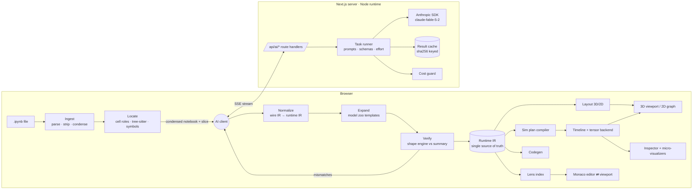

# 02 — System Architecture

## 1. Big picture

The app is a client-heavy Next.js application. Parsing, layout, verification, simulation and
rendering all happen **in the browser**. The server holds the Anthropic API key, runs the
Fable 5.2 tasks, caches their results, and enforces cost limits. Nothing ever executes the user's
Python.



## 2. Pipeline stages and contracts

Each stage is a pure function, or a pure core with a thin async wrapper, in `src/core/*` unless
noted. Stages exchange only Zod-validated types.

| # | Stage | Input → Output | Where | Notes |
|---|---|---|---|---|
| 1 | **Ingest** | `File` → `Notebook` | `core/notebook` | Parse nbformat 4.x (`source` may be a string or a list). Drop `image/*` and widget outputs. Convert HTML tables to text. Strip ANSI codes. Keep `text/plain` and `stream`, truncated. Never render HTML. |
| 2 | **Sanitize** | `Notebook` → `Notebook` | `core/python` | Comment out `!pip`, `%magic` and `%%cell` magics so tree-sitter can parse. **Preserve line numbers** (replace in place, never delete lines). |
| 3 | **Locate** | `Notebook` → `CellRoles + SymbolTable + ModelInventory(heuristic)` | `core/notebook`, `core/python` | Heuristics: imports (`torch.nn`, `keras.layers`, `sklearn`, `transformers`, `ultralytics`), patterns (`class X(nn.Module)`, `Sequential(`, `Model(inputs`, `.from_preset(`, `applications.`, `def build_`). Symbol table of top-level assignments with provenance. Output parsers: Keras 2/3 summaries, torchinfo, `print(model)`, `Found N images belonging to K classes`. |
| 4 | **Slice + condense** | `Notebook + roles` → `CondensedNotebook` | `core/notebook` | Keep model cells, the cells they depend on (symbol graph), imports and config. Shorten other cells to a one-line stub (`[cell 22: training loop, 31 lines, omitted]`). Prefix code lines with line numbers. Budget: ≤ 60k tokens. |
| 5 | **Extract** | `CondensedNotebook` → `WireIR` | `server/ai` | Fable 5.2 with a structured-output schema, effort `high`, streamed. See doc 05. |
| 6 | **Normalize** | `WireIR` → `RuntimeIR (draft)` | `core/ir` | Typed params per op (catalog Zod), symbol substitution, id hygiene, graph integrity checks (dangling edges, cycles, orphan nodes). |
| 7 | **Expand** | draft → draft | `core/zoo` | Replace `backbone` groups that carry a `zooKey` with curated templates (EfficientNetB0, MobileNetV2, ResNet50, ConvNeXt-T, ViT-B/16, YOLOv8n, ...). An unknown backbone gets an AI-synthesized template, flagged `provenance: "ai-synth"`. |
| 8 | **Verify** | draft + summaries → `RuntimeIR` + `VerificationReport` | `core/shapes` | Topological shape propagation, param counts and FLOPs, compared with LLM claims and parsed summaries. If there are mismatches, run **Repair** (stage 5b) at most twice, then present the result with flags. |
| 9 | **Layout** | `RuntimeIR + collapse state` → `Layout3D / Layout2D` | `core/layout` | A deterministic, cacheable layout (§6). |
| 10 | **Compile sim** | `RuntimeIR + focus` → `SimPlan` | `core/sim` | Topological schedule of steps. Collapsed groups become macro-steps (doc 04). |
| 11 | **Render / play** | `SimPlan + clock` → pixels | `features/*` | R3F viewport, inspector, timeline. |

Stages 3, 6–10 are deterministic and run in milliseconds, so the UI can re-run them freely,
for example when the user edits an assumption such as `num_classes`.

## 3. Module map

```
src/
├─ app/
│  ├─ page.tsx                     landing: drop zone + model gallery
│  ├─ scope/page.tsx               Scope workspace (also hosts Lens)
│  ├─ forge/page.tsx               Forge workspace
│  └─ api/ai/
│     ├─ inventory/route.ts        pass 1: cell roles + model list   (effort low)
│     ├─ extract/route.ts          pass 2: notebook → IR              (effort high)
│     ├─ repair/route.ts           verification diffs → IR patch      (effort medium)
│     ├─ lens/route.ts             code selection → snippet IR        (effort medium)
│     ├─ explain/route.ts          tutor chat (text stream)           (effort low/medium)
│     ├─ forge/route.ts            prompt → IR (+code)                (effort high)
│     └─ zoo/route.ts              unknown backbone → template        (effort medium)
├─ core/        (pure TS; see CLAUDE.md layout)
├─ server/ai/
│  ├─ config.ts                    model id, effort table, max_tokens, limits
│  ├─ client.ts                    Anthropic client singleton (import "server-only")
│  ├─ prompts/                     versioned system prompt + task instructions (.md files)
│  ├─ tasks/                       one module per task: build request, stream, validate
│  ├─ stream.ts                    SDK stream → SSE events (thinking summary, progress, result)
│  ├─ cache.ts                     sha256 → result, file cache in .cache/ai (gitignored)
│  └─ cost-guard.ts                token estimate (countTokens), per-day/month budget
├─ features/
│  ├─ notebook-map/   editor/   viewport-3d/   graph-2d/   inspector/
│  ├─ visualizers/    (one folder per micro-visualizer)
│  ├─ timeline/   neural-log/   forge/   gallery/   command-palette/   assumptions/
├─ components/ui/     GlassPanel, NeonButton, HudReadout, Chip, Toggle, Tooltip, Kbd, ...
├─ stores/            project, ir, sim, lens, ui, forge
└─ styles/            tokens.css, globals.css
```

**Dependency direction:** `app` → `features` → `stores` → `core`. `server` → `core`. `core`
depends on nothing in the app. Enforce this with `eslint-plugin-boundaries` (or `import/no-restricted-paths`).

## 4. State management (Zustand)

| Store | Holds | Notes |
|---|---|---|
| `projectStore` | loaded notebook, cell roles, symbol table, assumptions, selected model id | Persisted to IndexedDB per project. |
| `irStore` | runtime IR, verification report, collapse state, provenance | Immutable updates (immer). Undo/redo stack in Forge. |
| `simStore` | sim plan, clock (`t`, `playing`, `speed`), active step, tensor cache handles | The clock is read in `useFrame` via `getState()` with no React re-render per frame. |
| `lensStore` | editor selection, matched node ids, focus subgraph, snippet IR | |
| `uiStore` | panels, view mode (3D/2D), camera preset, theme, reduced motion | Persisted to localStorage (inside try/catch). |
| `forgeStore` | editable IR, palette state, codegen target (PyTorch/Keras) | |

## 5. Persistence and caching

- **IndexedDB (Dexie):** projects (stripped notebook, IR, assumptions, UI state), keyed by
  `sha256(notebook stripped JSON)`. Re-opening the same notebook is instant and free.
- **Server result cache:** `.cache/ai/<sha256>.json`, where the key is
  `sha256(taskName + promptVersion + model + effort + condensedInput)`. Bumping the prompt version
  invalidates the cache.
- **No server database in v1.** No accounts. Single user, local-first.

## 6. Layout

- **3D:** a left-to-right "data river". The main axis is topological depth. Parallel branches
  (Inception, multi-head, detection heads, FPN levels) fan out on the Y and Z axes. Groups get a
  bounding frame. Box sizes use log-scaled tensor dimensions (H, W → height and depth; C → width),
  clamped so a 4096-wide dense layer does not dwarf the scene.
- **2D:** ELK `layered` algorithm, used for large graphs, Forge editing, and as an accessibility
  alternative.
- **Collapse/LOD:** groups start collapsed when a model has more than ~150 primitive nodes, and
  repeated blocks render as one block plus "×N" ghost copies. Expanding a group animates the
  layout transition.
- Layout is computed in a Web Worker for graphs above ~300 nodes.

## 7. Security and privacy

- **No code execution.** We never run the user's Python, `eval`, or a notebook output.
- **XSS:** notebook markdown is rendered with a sanitizing renderer (no raw HTML), and HTML outputs are dropped.
- **Prompt injection:** notebook content is wrapped in tagged data blocks, and the system prompt
  says it is untrusted data. Outputs are constrained by the schema and then validated by Zod and
  the shape engine. The model's output can never trigger actions.
- **Secrets:** `ANTHROPIC_API_KEY` lives in `.env.local` on the server. `src/server/**` uses
  `import "server-only"`. The browser never sees the key.
- **Data sent to Anthropic:** the condensed notebook text (code, markdown excerpts, text outputs).
  Fable 5.2 requires 30-day data retention, so it is not available under ZDR. The UI discloses
  this on first use, and **Local-only mode** (heuristics + zoo + manual IR editing, no AI) is
  always available.
- **Upload limits:** notebooks are stripped in the browser before anything is sent. The server
  rejects condensed payloads above the configured token budget.

## 8. Performance strategy

- Instanced meshes per glyph type, a merged edge geometry, and a GPU particle system for data pulses.
- Bloom postprocessing at a capped resolution, with an adaptive DPR (`drei`'s `PerformanceMonitor`).
- Tensor previews are downsampled to ≤ 128×128 per channel and ≤ 16 channels per layer before
  becoming textures. Large activations stay as tfjs tensors and are disposed eagerly.
- Heavy work (layout of big graphs, summary parsing of huge outputs, tree-sitter) runs in Web Workers.
- The 3D bundle is code-split (`next/dynamic`, no SSR for R3F and Monaco).

## 9. Degraded modes

| Situation | Behavior |
|---|---|
| No API key / offline | Local-only mode: heuristic IR for simple Sequential and `nn.Sequential` models (fast-path parser), the zoo, the gallery, and manual editing in Forge. |
| Refusal from Fable 5.2 | Server-side fallback model (see doc 05). If that also refuses, show the category with a friendly message and offer Local-only mode. |
| `max_tokens` hit | Retry once per model (one request per model id) with a larger `max_tokens`. |
| Verification mismatch after repair | Show the IR anyway, with ⚠ badges and an *Assumptions* panel where the user can fix symbols (e.g., `num_classes`), then re-verify instantly. |
| WebGPU/WebGL unavailable | Symbolic compute tier only (procedural activations), clearly labelled. |

## 10. Testing strategy

- **Unit (Vitest):** everything in `core/`, especially catalog shape/param functions against
  golden numbers (doc 07), summary parsers against the real outputs captured from the reference
  notebooks, and the Lens range mapping.
- **Component (RTL):** inspector, timeline, notebook map.
- **E2E (Playwright):** drop a fixture notebook → gallery IR → play the simulation → Lens selection.
  Screenshot regression of the 3D viewport with deterministic camera presets.
- **AI evals (`pnpm eval:ai`, paid, ask first):** run extraction on the fixture notebooks and score
  the results against `fixtures/expectations/*.json` (models found, op counts, total params,
  key shapes, repeat counts). Store the reports so regressions show up.

## 11. Tech stack rationale (summary; full ADRs in doc 09)

| Concern | Choice | Why | Rejected alternatives |
|---|---|---|---|
| App framework | Next.js + TS | One language end to end; server routes keep the key safe; the official Anthropic TS SDK | Python FastAPI backend (no need to run Python in v1) |
| 3D | React Three Fiber | Declarative three.js, huge ecosystem (drei, postprocessing), fits React state | Babylon.js, raw three.js |
| 2D graph | React Flow + ELK | Mature editing UX for Forge, good layered layout | Cytoscape, D3 force |
| Code editor | Monaco | Decorations, selection API, Python highlighting, VS Code feel | CodeMirror 6 (a fine fallback) |
| Python parsing | web-tree-sitter | Real CST in the browser with exact ranges; tolerant of errors | Regex only; Pyodide (too heavy) |
| Compute | tfjs (WebGPU/WebGL) | Real conv/matmul on the GPU in the browser; per-op API fits an IR interpreter | ONNX Runtime Web (cannot easily build graphs from IR), custom WebGPU kernels (later, if needed) |
| State | Zustand | Minimal API, works outside React (R3F loops) | Redux, Jotai |
| Validation | Zod | One schema for runtime validation, TS types and Claude structured outputs (`zodOutputFormat`) | |
